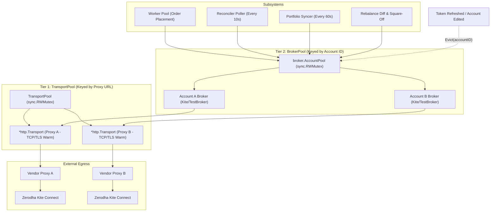
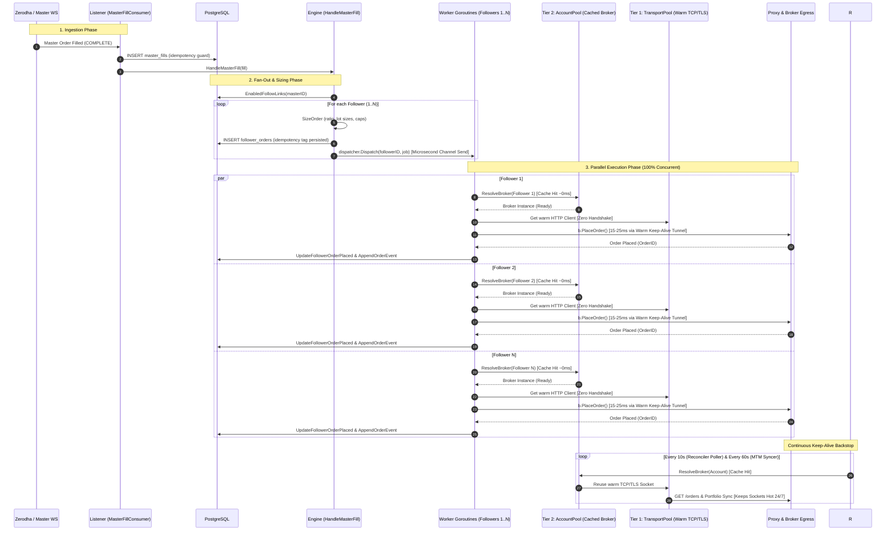

# Implementation Plan: Account-Scoped Broker & Client Cache (Two-Tier Connection Pooling)

## Goal Description
Reduce hot-path order latency from ~120ms to ~15–25ms on a 2-core 8GB system by eliminating cold TCP/TLS handshakes through dedicated proxies.
Implement **Option 1 (Account-Scoped Broker / Client Cache)** using a **Two-Tier Architecture**:
1. **Tier 1 (Transport Pool):** A persistent, concurrency-safe `*http.Transport` pool that retains warm TCP/TLS sockets per egress proxy/endpoint across all accounts.
2. **Tier 2 (Account Broker Pool):** A thread-safe `BrokerManager` that caches instantiated `broker.Broker` instances per account ID, unifying Worker Pool, Reconciler Poller, Portfolio Syncer, Rebalance, and Square-Off.
3. **Invalidation on Mutation:** Token refreshes, credential edits, and proxy changes evict the account from Tier 2, lazily re-instantiating the broker while preserving Tier 1's warm network socket.
4. **OS Limits Scaling:** Enforce `LimitNOFILE=65535` in systemd and log current `rlimit` at process startup, safely unlocking scale up to 2,000–5,000 accounts.

---

## User Review Required

> [!IMPORTANT]
> **Two-Tier Architecture Boundary:**
> - **Tier 1 (`TransportPool`):** Manages long-lived `*http.Transport` instances keyed by proxy URL (`Scheme://Host:Port`). If an account's token expires or rotates, Tier 1's TCP/TLS connection stays connected and ready.
> - **Tier 2 (`BrokerPool`):** Manages `broker.Broker` instances keyed by `uuid.UUID` account ID. Evicted on credential mutation so stale tokens are never used.

> [!NOTE]
> **Reconciler & Syncer Unification:**
> Currently, `recon.Poller` and `kite.PortfolioSyncer` create a brand new `*http.Client` every 10–60 seconds, dialing fresh TCP connections. Unifying them under the shared `BrokerPool` / `TransportPool` turns the 10-second reconciler ping into a free connection warmer, keeping sockets hot 24/7.

---

## Architecture Overview



### Copy-Trading Fan-Out Pipeline (With Two-Tier Cache)



---

## Proposed Changes

### Phase 1: Tier 1 — Persistent Transport Pool (`internal/kite/proxy.go` & `internal/testbroker/`)

Introduce a global/shared `TransportPool` that returns long-lived `*http.Client` instances sharing a cached `*http.Transport`.

#### [MODIFY] `internal/kite/proxy.go`
- Add `TransportPool` struct with `sync.RWMutex` mapping proxy URL string -> `*http.Transport`.
- Configure `MaxIdleConnsPerHost = 4`, `IdleConnTimeout = 90 * time.Second`.
- Add `GetClient(cfg *ProxyConfig) (*http.Client, error)`:
  - If `cfg == nil` or `cfg.Host == ""` -> returns client with default pooled transport.
  - If `cfg != nil` -> returns client sharing the cached `*http.Transport` for that proxy URL.
- Update `NewLiveBroker` to accept the pooled `*http.Client` instead of creating new transports on every call.

---

### Phase 2: Tier 2 — Account-Scoped Broker Pool (`internal/broker/pool.go`)

Create a broker-agnostic account cache satisfying the `BrokerResolver` interface across all brokers (`kite`, `testbroker`, and future adapters).

#### [NEW] `internal/broker/pool.go`
```go
package broker

import (
    "context"
    "sync"
    "github.com/google/uuid"
)

type AccountPool struct {
    mu       sync.RWMutex
    brokers  map[uuid.UUID]Broker
    resolver func(ctx context.Context, id uuid.UUID) (Broker, error)
}

func NewAccountPool(resolver func(ctx context.Context, id uuid.UUID) (Broker, error)) *AccountPool {
    return &AccountPool{
        brokers:  make(map[uuid.UUID]Broker),
        resolver: resolver,
    }
}

func (p *AccountPool) ResolveBroker(ctx context.Context, id uuid.UUID) (Broker, error) {
    p.mu.RLock()
    b, ok := p.brokers[id]
    p.mu.RUnlock()
    if ok {
        return b, nil
    }

    p.mu.Lock()
    defer p.mu.Unlock()
    // Double-check
    if b, ok := p.brokers[id]; ok {
        return b, nil
    }

    fresh, err := p.resolver(ctx, id)
    if err != nil {
        return nil, err
    }
    p.brokers[id] = fresh
    return fresh, nil
}

func (p *AccountPool) Evict(id uuid.UUID) {
    p.mu.Lock()
    delete(p.brokers, id)
    p.mu.Unlock()
}

func (p *AccountPool) EvictAll() {
    p.mu.Lock()
    p.brokers = make(map[uuid.UUID]Broker)
    p.mu.Unlock()
}
```

#### [NEW] `internal/broker/pool_test.go`
- Unit tests verifying:
  - Cache hits return exact same `Broker` pointer.
  - Concurrent `ResolveBroker` calls do not race (verified via `-race`).
  - `Evict(id)` triggers fresh instantiation on next resolve.
  - Multi-broker support: verifies different broker accounts resolve independently.

---

### Phase 3: Wire Pool & Invalidation Hooks in Server (`cmd/server/main.go` & `internal/httpapi/`)

#### [MODIFY] `cmd/server/main.go`
- Instantiate `broker.AccountPool` wrapping `serverBrokerResolver.resolveFreshBroker`.
- Pass `AccountPool` as the `BrokerResolver` to:
  - `worker.Pool`
  - `rebalance.Service`
  - `squareoff.Service`
  - `serverMasterReader` & `serverFollowerReader` (unifying Reconciler to reuse the warm connection).
  - `rawSyncer.APIFactory` (reusing Tier 1 transport pool).
- Hook cache invalidation:
  - `rawSyncer.OnTokenRefreshed`: call `accountPool.Evict(accountID)`.
  - Pass `accountPool` (as `BrokerEvicter` interface) to `httpapi.Router`.
- Startup Limit Check:
  - Log `rlimit` (soft and hard file limits) via `slog.Info` on server startup so systemd `LimitNOFILE` status is visible in logs.

#### [MODIFY] `internal/httpapi/accounts.go` & `internal/httpapi/router.go`
- Add `BrokerEvicter` interface:
  ```go
  type BrokerEvicter interface {
      Evict(accountID uuid.UUID)
  }
  ```
- Call `evicter.Evict(id)` when:
  - Account credentials, API key/secret, or IP address are patched in `patchAccount`.
  - Account is deleted in `deleteAccount`.

---

### Phase 4: Testbroker & End-to-End Sanity Verification

#### [MODIFY] `internal/testbroker/factory.go` / `internal/testbroker/broker.go`
- Ensure `testbroker.Factory` properly cooperates with pooled HTTP transports.
- Run testbroker integration and e2e test suite to guarantee zero regressions.

---

## Verification Plan

### Automated Tests
1. **Unit & Race Detection Tests:**
   ```sh
   go test -race ./internal/broker/...
   go test -race ./internal/kite/...
   go test -race ./internal/httpapi/...
   go test ./...
   ```
2. **Integration & E2E Tests with TestBroker:**
   ```sh
   go test -tags e2e ./tests/e2e/... -v
   ```
   Must pass:
   - `TestE2E_BrokerAuthExpiration_DoesNotInvalidateTraderWebSession`
   - `TestE2E_FollowerActivationFlow_And_CopyTradeScenarios`
   - All standard e2e copy-trade scenarios.
3. **Frontend Tests & Build:**
   ```sh
   pnpm -C frontend test --run
   pnpm -C frontend build
   ```

### Performance & Keep-Alive Verification
1. Add an automated benchmark/test `TestAccountPool_ConnectionReused_NoNewDial` that asserts consecutive calls to `ResolveBroker(id)` make HTTP requests over the existing TCP socket (`httptrace.GotConn` with `Reused: true`).
