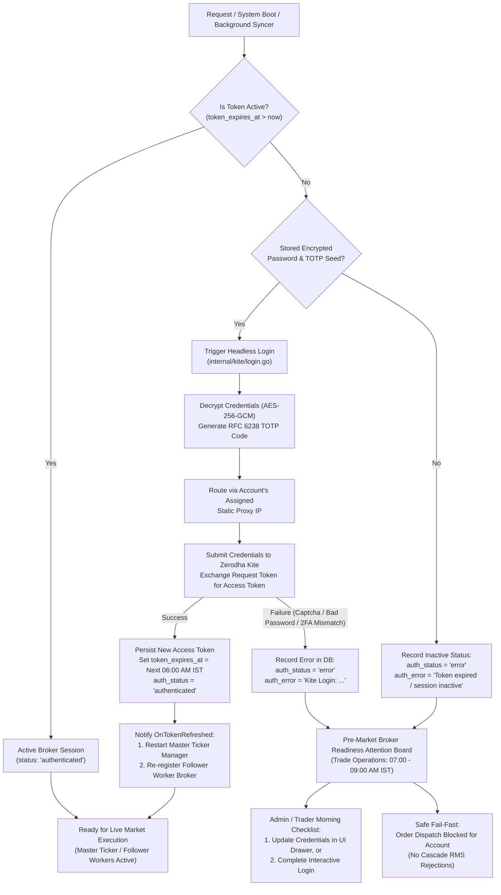
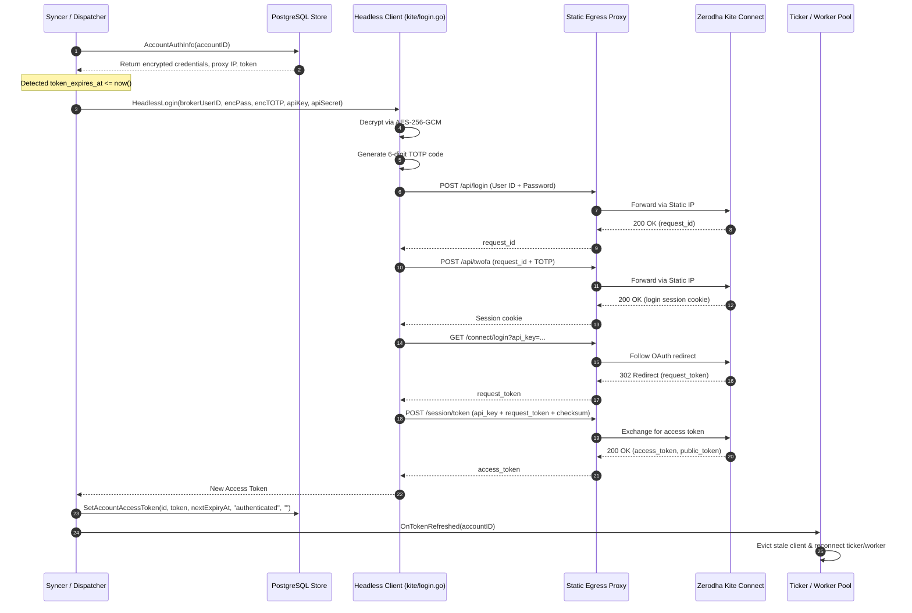

# Broker Authentication Lifecycle & Token Renewal

This document details the authentication lifecycle for broker accounts (primarily Zerodha Kite Connect), headless auto-renewal, fail-safe mechanisms for missed schedules, and pre-market readiness procedures in EnvoyTrade.

---

## 1. Core Principles & Expiration Rules

1. **Daily Expiration Cutoff**:
   - Zerodha Kite Connect access tokens **strictly expire at 06:00 AM IST every single day**, regardless of when they were issued.
   - Any token with an expiration timestamp before `now()` or with `NULL` expiration is considered inactive.
2. **Entitlement & Refresh Tokens**:
   - Standard Kite Connect apps do **not** provide OAuth refresh tokens (refresh token entitlement is a separate paid add-on from Zerodha).
   - EnvoyTrade bridges this gap using an automated **Headless 2FA Login Client** (`internal/kite/login.go`) for accounts configured with encrypted credentials.
3. **Fail-Fast Safety (No Silent RMS Failures)**:
   - When an account's token is expired or unauthenticated, the engine refuses order placement (`domain.ErrAuthExpired`).
   - Copy-trading orders are **never** dispatched with unauthenticated or unverified sessions, avoiding cascading RMS rejections and broker rate penalties.

---

## 2. Authentication & Self-Healing Decision Flow

EnvoyTrade evaluates token validity **dynamically in Go memory on every operation** rather than relying solely on a fixed scheduled cron. If a 6:00 AM job is missed (e.g. server reboot, network blip), the system self-heals on-demand.



---

## 3. Headless Auto-Login Sequence

When token renewal triggers, the following 5-step sequence runs through the account's assigned static proxy IP:



---

## 4. Handling Missed 6:00 AM Schedules

If the scheduled 6:00 AM trigger does not run (for instance, the server was offline overnight and started at 07:30 AM), EnvoyTrade handles it through multiple defensive layers:

| Layer | Mechanism | Impact |
|---|---|---|
| **1. Lazy In-Memory Evaluation** | Go evaluates `token_expires_at.Before(now)` dynamically inside `accountFromRow` and `BrokerReadiness`. | No stale "authenticated" state is ever returned to clients or execution pipelines, even if the DB row wasn't updated by a cron. |
| **2. Self-Healing on Access** | Any portfolio synchronization, manual trigger, or administrative check invokes `SyncAccountPortfolio`. | Tokens are re-authenticated headlessly on-demand in <1.5s as soon as the service boots. |
| **3. Mid-Day Invalidation Catch** | If an active session is revoked mid-day (e.g. mobile app login conflict), `IsAuthError(err)` intercepts Kite `TokenException` or HTTP 403. | Immediately attempts re-login, evicts the stale cached broker, and resumes without process restarts. |
| **4. Pre-Market Visual Checklist** | The **Pre-Market Broker Readiness** dashboard (`/admin/operations`) aggregates all accounts between 07:00 AM and 09:00 AM IST. | Operators have visual confirmation that all masters and followers are ready before market open at 09:15 AM IST. |
| **5. Strict SEBI / Risk Refusal** | If an account remains in an error state at market open, `engine.HandleMasterFill` refuses order placement for that follower (`ErrAuthExpired`). | Zero orphaned orders or broker account locking. |

---

## 5. Next Cutoff Calculation

The expiration boundary is determined by `NextKiteExpiry`:

```go
func NextKiteExpiry(now time.Time) time.Time {
    nowIST := now.In(domain.IST)
    target := time.Date(nowIST.Year(), nowIST.Month(), nowIST.Day(), 6, 0, 0, 0, domain.IST)
    if !nowIST.Before(target) {
        target = target.AddDate(0, 0, 1)
    }
    return target
}
```

- Any token renewed at 06:15 AM IST on day $D$ is valid until 06:00 AM IST on day $D+1$.
- Any token renewed at 05:45 AM IST on day $D$ is valid until 06:00 AM IST on day $D$.

---

## 6. Related Documentation

- For web dashboard and platform user authentication lifecycle, idle sliding timeout, and maximum ceiling rules, see [Platform User Session Lifecycle](USER_SESSION_LIFECYCLE.md).

