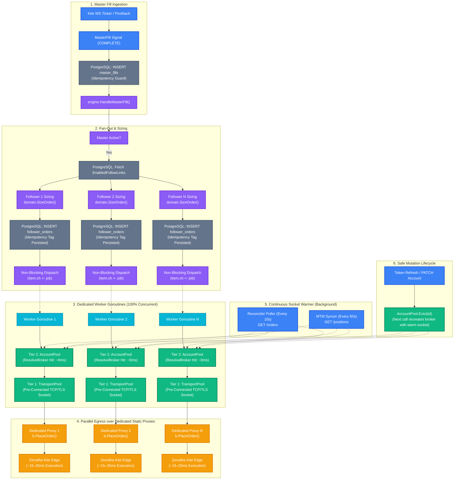
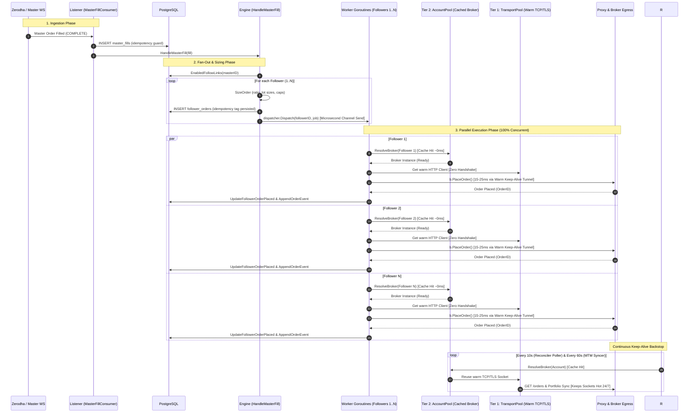

# Fan-Out Mechanism V2 (Two-Tier Connection Pool & Low-Latency Copy Trading)

This document describes the V2 fan-out copy-trading pipeline in EnvoyTrade, designed for sub-25ms order placement across N follower accounts on a 2-core 8GB system.

---

## 1. End-to-End Fan-Out Flowchart

---

## 2. Fan-Out Sequence Diagram

---

## 3. Core Architectural Guarantees

1. **Idempotency Persisted Before Network:**
   The `follower_orders` row with deterministic `idempotency_tag` is written to PostgreSQL **before** any broker dispatch. Redeliveries safely no-op without double-ordering.
2. **Microsecond Channel Dispatch:**
   `dispatcher.Dispatch` pushes to an in-memory buffered channel (`ch <- job`) and returns immediately. If a follower's channel is full, it fails fast and dead-letters without stalling fan-out to other followers.
3. **Dedicated Goroutines per Follower:**
   Worker goroutines execute 100% concurrently in parallel, each with its own egress proxy client and rate limiter (~8–10 orders/s).
4. **Two-Tier Cache:**
   - **Tier 1 (`TransportPool`):** Retains open TCP/TLS Keep-Alive sockets per egress proxy URL.
   - **Tier 2 (`AccountPool`):** Caches `broker.Broker` instances per account ID.
5. **Continuous Keep-Alive:**
   The Reconciler Poller (10s) and MTM Syncer (60s) keep the underlying sockets warm, avoiding the ~100ms cold handshake penalty when the master trades.
