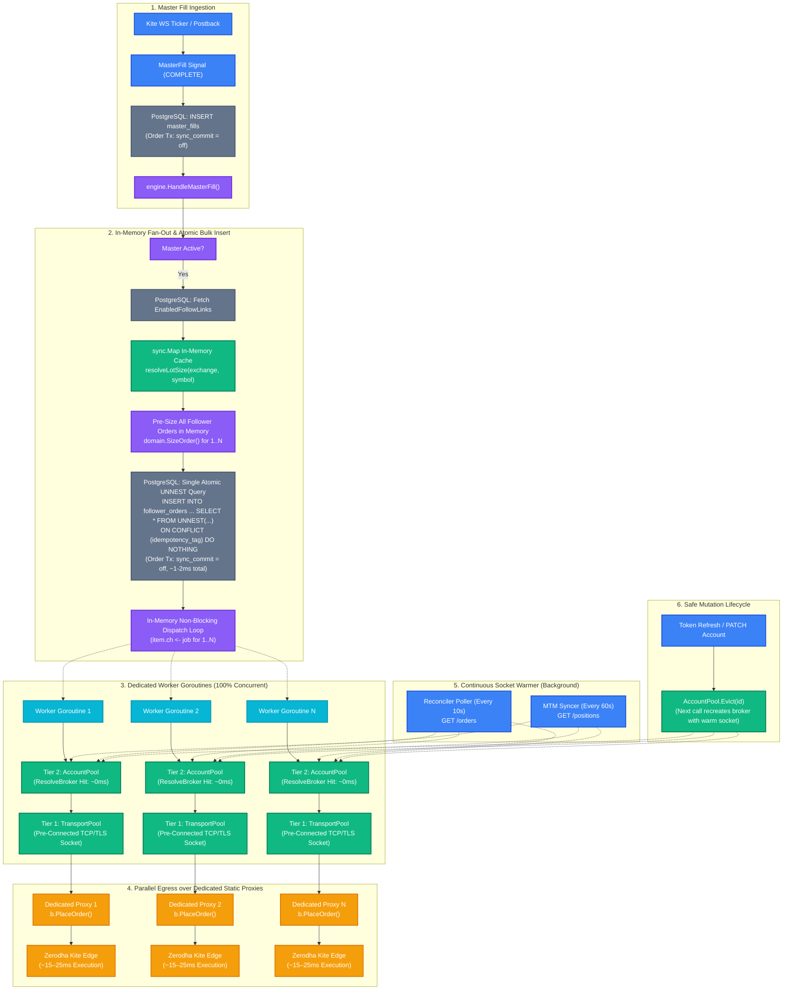
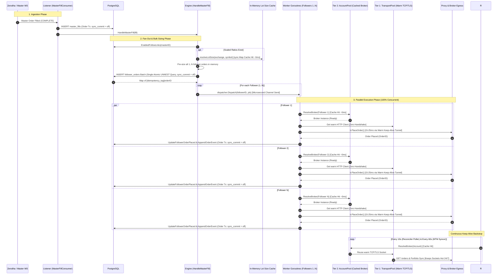

# Fan-Out Mechanism V2.1 (Atomic UNNEST Bulk Insert & Two-Tier Connection Pool)

This document describes the V2.1 fan-out copy-trading pipeline in EnvoyTrade, designed for sub-millisecond in-memory engine fan-out and sub-25ms order placement across N follower accounts on a 2-core 8GB system.

---

## 1. End-to-End Fan-Out Flowchart

---

## 2. Fan-Out Sequence Diagram

---

## 3. Core Architectural Guarantees

1. **Atomic Bulk Insertion via PostgreSQL `UNNEST`:**
   Instead of sequential per-follower database inserts, the engine pre-sizes all follower orders in RAM and persists them in a **single atomic PostgreSQL `UNNEST` query**. A master fill fanning out to 10–50 followers takes **1 database roundtrip** instead of N roundtrips.
2. **Transaction-Scoped `synchronous_commit = off`:**
   Order write transactions (`master_fills`, `follower_orders`, `order_events`, `pending_order_updates`) execute with `SET LOCAL synchronous_commit = 'off'`. WAL records write directly to RAM buffer cache and flush asynchronously, dropping database write latency from **2–5ms down to ~0.2ms** while preserving full ACID constraints. Accounts, credentials, and authentication tables remain on default `synchronous_commit = 'on'`.
3. **In-Memory Lot Size Cache:**
   Instrument lot sizes are cached in a thread-safe `sync.Map` (`EXCHANGE:TRADINGSYMBOL`), purged daily at **01:00:00 IST**. Eliminates redundant database roundtrips on the execution hot path.
4. **Idempotency Persisted Before Network:**
   The `follower_orders` row with deterministic `idempotency_tag` is written to PostgreSQL **before** any broker dispatch. Redeliveries safely no-op via `ON CONFLICT (idempotency_tag) DO NOTHING`.
5. **Microsecond Channel Dispatch:**
   `dispatcher.Dispatch` pushes to an in-memory buffered channel (`ch <- job`) and returns immediately. If a follower's channel is full, it fails fast and dead-letters without stalling fan-out to other followers.
6. **Dedicated Goroutines per Follower:**
   Worker goroutines execute 100% concurrently in parallel, each with its own egress proxy client and rate limiter (~8–10 orders/s).
7. **Two-Tier Cache:**
   - **Tier 1 (`TransportPool`):** Retains open TCP/TLS Keep-Alive sockets per egress proxy URL.
   - **Tier 2 (`AccountPool`):** Caches `broker.Broker` instances per account ID.
8. **Continuous Keep-Alive:**
   The Reconciler Poller (10s) and MTM Syncer (60s) keep the underlying sockets warm, avoiding the ~100ms cold handshake penalty when the master trades.
