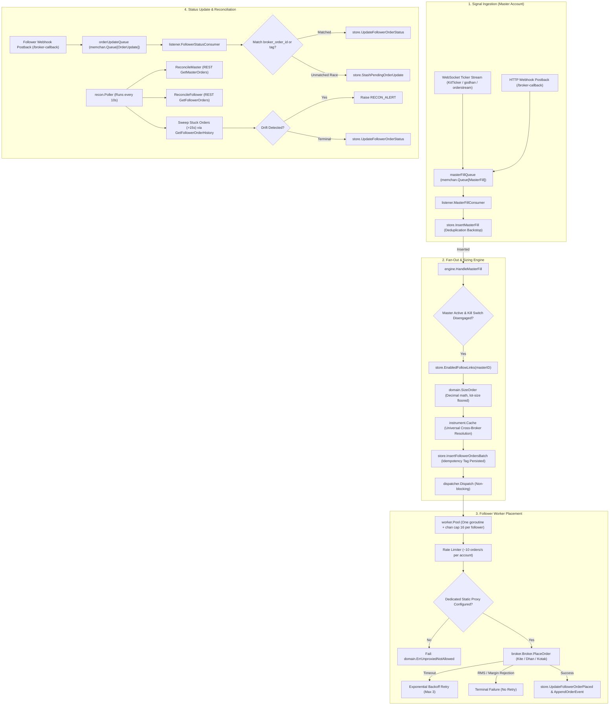

# Master-to-Follower Copy-Trade Code Flow Review

This document presents a comprehensive, end-to-end architectural and code-level review of EnvoyTrade's copy-trading pipeline across the three supported broker ecosystems: **Dhan (DhanHQ API v2)**, **Kotak Neo (Trade API)**, and **Zerodha (Kite Connect v4)**.

---

## 1. System Architecture Overview

EnvoyTrade implements a strictly isolated, consumer-driven copy-trade pipeline with zero shared store interfaces, deterministic idempotency, decimal-only financial math, and dedicated static proxy egress for all follower accounts.



---

## 2. Multi-Broker Permutation Matrix Analysis

The table below maps the complete lifecycle and data transformations across all **9 master-to-follower combinations**:

| Permutation | Master Signal Ingestion | Cross-Broker Translation | Sizing & Idempotency | Follower Placement (Adapter) | Follower Status / Recon |
|---|---|---|---|---|---|
| **1. MSP Dhan &rarr; MSP Kotak** | Dhan WS (`dhanws.MasterTicker`) or Dhan Webhook &rarr; `masterFillQueue` | Dhan `SecurityID` mapped to canonical symbol &rarr; Kotak symbol (`mcx_fo`, `CRUDEOIL17NOV265000PE`) | Decimal ratio (`CloneFactor`), floored to lot multiples via `instrument.Cache` | Kotak Neo `broker.Broker` via static proxy; MCX unit conversion via `ToMCXOrderUnits` | Kotak REST recon poller (`ReconcileFollower` / `GetFollowerOrderHistory`) |
| **2. Kotak &rarr; Kotak** | Kotak WS (`orderstream.Client`) &rarr; `masterFillQueue` | Normalized MCX qty &rarr; Kotak symbol pass-through | Standard lot sizing; DB unique tag | Kotak `broker.Broker` via dedicated static proxy | Kotak REST recon poller |
| **3. Dhan &rarr; Dhan** | Dhan WS or Webhook &rarr; `masterFillQueue` | Dhan `SecurityID` reverse-resolved to canonical | Sized using canonical lot size | Dhan `broker.Broker` resolves follower's `SecurityID` & `ExchangeSegment` | Dhan Webhook postback + REST recon |
| **4. Kotak &rarr; Dhan** | Kotak WS (`orderstream.Client`) &rarr; `masterFillQueue` | Kotak symbol reverse-resolved to canonical | Sized using canonical lot size | Dhan `broker.Broker` resolves `SecurityID` & `ExchangeSegment` via `ResolveForBroker("dhan")` | Dhan Webhook postback + REST recon |
| **5. Kotak &rarr; Zerodha** | Kotak WS (`orderstream.Client`) &rarr; `masterFillQueue` | Kotak symbol mapped to Kite canonical symbol (strips `-EQ` for cash equity) | Sized using Kite instrument lot size | Kite `broker.Broker` via static proxy; `Tradingsymbol` + `Exchange` | Kite Postback webhook + REST recon |
| **6. Zerodha &rarr; Kotak** | Kite WS (`MasterTicker`) or Kite Postback &rarr; `masterFillQueue` | Kite symbol mapped to Kotak symbol (enriches MCX day via `enrichContractDay`, appends `-EQ` for cash) | Sized using Kite/canonical lot size | Kotak `broker.Broker` via static proxy; `Es` segment + `Qt` MCX conversion | Kotak REST recon poller |
| **7. Zerodha &rarr; Dhan** | Kite WS or Kite Postback &rarr; `masterFillQueue` | Kite symbol parsed into `CanonicalContract` &rarr; mapped to Dhan `SecurityID` + `ExchangeSegment` | Sized using canonical lot size | Dhan `broker.Broker` via proxy (`SecurityID` + `ProductType` + `CorrelationID`) | Dhan Webhook postback + REST recon |
| **8. Zerodha &rarr; Zerodha** | Kite WS or Kite Postback &rarr; `masterFillQueue` | Pure Kite `Tradingsymbol` & `Exchange` | Sized via Kite lot size | Kite `broker.Broker` via static proxy | Kite Postback webhook (checksum validated per account) + REST recon |
| **9. Dhan &rarr; Zerodha** | Dhan WS or Webhook &rarr; `masterFillQueue` | Dhan `SecurityID` reverse-resolved &rarr; Kite `Tradingsymbol` formatted via `ToKiteSymbol()` | Sized via canonical lot size | Kite `broker.Broker` via static proxy | Kite Postback webhook + REST recon |

---

## 3. Deep-Dive Review by Pipeline Stage

### Stage 1: Authentication & Perpetual Session Management

#### Zerodha Kite Connect
- **Implementation**: `internal/kite/login.go`, `internal/kite/sync.go`.
- **Credential Storage**: API Key, API Secret, encrypted password, and encrypted TOTP secret stored in `accounts` table using AES-256-GCM (`internal/crypto/aes.go`).
- **Session Exchange**: Headless login automates TOTP generation (`internal/kite/totp.go`), retrieves `request_token`, and calls Kite API `GenerateSession` to obtain a 24-hour `access_token`.
- **Dynamic Renewal**: Handled transparently by `kite.PortfolioSyncer`. If an account encounters `401 Unauthorized` or token expiry, it executes re-authentication, updates `access_token` in Postgres, and fires `OnTokenRefreshed`.
- **Worker & Ticker Dynamic Refresh**: `rawKiteSyncer.OnTokenRefreshed` calls `handleTokenRefreshed`:
  - Evicts stale broker client from `accountPool`.
  - For Master: restarts WebSocket ticker (`tickerManager.RestartMaster`).
  - For Follower: cancels old worker and spins up a new worker goroutine with fresh session (`followerRegistrar.RegisterFollower`).

#### Dhan (DhanHQ API v2)
- **Implementation**: `internal/dhan/renewer.go`, `internal/dhan/jwt.go`, `internal/dhan/client.go`.
- **Credential Storage**: Dhan Client ID (`api_key` or `broker_account_id`), static or renew-capable JWT token (`access_token`).
- **Scheduled Renewer**: Autonomous background daemon runs at **12:15 AM & 06:00 AM IST** daily. Checks expiration via JWT claim parsing (`jwt.ParseExpiry`), requests fresh access tokens from Dhan authentication endpoints, and persists them to Postgres.
- **Dynamic Re-registration**: `dhanRenewer.OnTokenRefreshed` fires `accountPool.Evict(accountID)` and `handleTokenRefreshed` to reload connections across master tickers and follower workers.

#### Kotak Neo (Trade API)
- **Implementation**: `internal/kotak/auth.go`, `internal/kotak/renewer.go`, `internal/kotak/sync.go`.
- **Credential Storage**:
  - `api_key`: 10-digit mobile number, normalized to digits via `NormalizeMobileNumber`.
  - `api_secret`: Kotak Consumer Key.
  - `encrypted_password`: Kotak MPIN (AES-256-GCM).
  - `encrypted_totp_secret`: Kotak TOTP secret (AES-256-GCM).
  - `access_token`: Serialized JSON payload `TradeSessionJSON` containing `Token`, `Sid`, `BaseURL`, `FeedURL`, and `RTURL`.
- **2-Step Authentication Flow**:
  1. `GetToken`: Submits Consumer Key, Mobile Number, and TOTP code &rarr; returns temporary session token and gateway URLs.
  2. `GetSession`: Submits temporary token and MPIN &rarr; returns live trade token (`Token`) and session identifier (`Sid`).
- **Scheduled Renewer**: Autonomous background daemon runs at **06:30 AM IST** daily (`kotak.Renewer`).
- **Dynamic Refresh**: On token renewal, `kotakRenewer.OnTokenRefreshed` and `rawKotakSyncer.OnTokenRefreshed` evict stale pool entries and dynamically restart tickers or follower workers.

#### Proxy Egress Enforcement
- Follower accounts **strictly require** dedicated static proxy egress (`acc.ProxyHost`, `acc.ProxyPort`, `acc.ProxyUsername`, `acc.ProxyPassword`).
- If an account is configured as a follower without an assigned proxy IP, resolution fails immediately with `domain.ErrIPRequired`.
- If any broker adapter attempts an unproxied order placement, it returns `domain.ErrUnproxiedNotAllowed`.

---

### Stage 2: Trade Ingestion (Master Execution Ingestion)

#### Dynamic WebSocket Ticker Management
- `internal/ticker/manager.go` dynamically starts and manages an isolated WebSocket connection for each active master account:
  - **Kite**: `kite.TickerFactory` &rarr; `callback.MasterTicker` wrapping `*kiteticker.Ticker`.
  - **Dhan**: `dhanws.TickerFactory` &rarr; `dhanws.MasterTicker` wrapping `dhanticker.Ticker`.
  - **Kotak Neo**: `kotakws.MasterTickerFactory` &rarr; `kotakws.MasterTicker` wrapping `gokotakneo/orderstream.Client`.
- **Automatic Reconnection & Catch-Up Hook**:
  - Upon network disruption and subsequent reconnection, `kotakws.MasterTicker` executes its `catchUp` callback.
  - The catch-up callback triggers `poller.ReconcileMaster`, querying the broker REST API to backfill any fills that executed during the socket downtime.

#### Terminal Status Filtering
- All broker ticker adapters drop intermediate non-terminal states (`OPEN`, `TRIGGER PENDING`, `TRANSIT`, `MODIFIED`) at the adapter boundary.
- Only terminal statuses (`COMPLETE` / `TRADED`, `REJECTED`, `CANCELLED`) are forwarded to `masterFillQueue`.

#### HTTP Postback Webhook Ingestion (`/broker-callback`)
- `internal/callback/router.go` implements zero-allocation raw byte fingerprinting:
  - `"dhanClientId"` &rarr; routed to `dhancallback.Handler`.
  - `"nOrdNo"` + `"trdSym"` &rarr; fingerprinted as `kotakneo`.
  - `"checksum"` + `"user_id"` &rarr; routed to `kite/callback.Handler`.
  - Fallback &rarr; default Kite handler.
- **Checksum Verification**:
  - Zerodha Kite postbacks calculate SHA-256 over `order_id + order_timestamp + api_secret`.
  - `kite/callback.Handler` resolves the account from Postgres by `user_id` and verifies using that specific account's `api_secret`.

#### Dual-Path Ingestion & Database Deduplication
- Because both WebSocket ticker and HTTP postbacks can deliver the same fill, deduplication is enforced by Postgres unique constraint on `master_fills`:
  `UNIQUE (master_id, broker_order_id, filled_quantity, status)`
- When a duplicate fill is inserted, `store.InsertMasterFill` returns `domain.ErrDuplicate`.
- `listener.MasterFillConsumer.Handle` catches `ErrDuplicate` and treats it as a silent no-op, preventing duplicate fan-out.

---

### Stage 3: Trade Fan-Out, Decimal Sizing & Cross-Broker Symbol Translation

#### Fan-Out Engine Execution (`internal/engine/engine.go`)
1. **Emergency Kill Switch**: Evaluates `e.IsKillSwitchEngaged()`. If active, fan-out is halted immediately, and the master fill is marked `DispatchDispatched`.
2. **Terminal Verification**: If `fill.Status != domain.TerminalComplete`, fan-out is skipped.
3. **Master Active Check**: Queries `store.MasterActive(ctx, fill.MasterID)`. If false (stopped via dashboard), fan-out is skipped.
4. **Follow Links**: Queries `store.EnabledFollowLinks(ctx, fill.MasterID)` to resolve target followers.

#### Decimal-Only Sizing (`domain.SizeOrder`)
- Financial math is strictly calculated using `shopspring/decimal` (zero `float64` in sizing calculations).
- Order quantity = `floor(masterQty * cloneFactor / lotSize) * lotSize`.
- Enforces caps: `link.MaxQtyPerOrder`.
- Persists audit trail sizing reasons:
  - `ReasonOK`: Valid sized order.
  - `ReasonBelowOneLot`: Calculated quantity fell below 1 contract lot (sized to 0).
  - `ReasonCapped`: Sized quantity exceeded `MaxQtyPerOrder` and was capped.
  - `ReasonFollowerInError`: Follower account in error state (sized to 0).
  - `ReasonFollowerPending`: Follower account pending activation (sized to 0).

#### Universal Cross-Broker Instrument Translation (`internal/instrument`)
- **Unified Cache**: Pre-allocated in-memory cache (`instrument.Cache`) with 10,000 capacity.
- **Canonical Model (`CanonicalContract`)**:
  - Decomposes any broker's symbol into:
    `{Exchange, Underlying, ExpiryDate, HasDay, Strike, OptionType, IsOption, IsFuture, IsEquity}`
- **Universal Keys**:
  - Equity: `NSE:RELIANCE:EQ`
  - Option with day: `MCX:CRUDEOIL:2026-11-17:5000:PE`
  - Option month: `NFO:NIFTY:2026-11:24000:CE`
  - Future with day: `MCX:CRUDEOIL:2026-09-21:FUT`
  - Future month: `NFO:NIFTY:2026-10:FUT`
- **Key Discrepancies Handled**:
  1. **MCX Expiry Day Enrichment**: Kite uses dayless monthly symbols (`CRUDEOIL26NOV5000PE`), but Kotak and Dhan require exact days (`CRUDEOIL17NOV265000PE`). `Cache.enrichContractDay` cross-references active Dhan and Kotak contracts in memory to enrich Kite contracts with the exact expiry day.
  2. **MCX Quantity Conversions**: Kotak Neo requires commodity units (e.g. 100 barrels), whereas Kite and Dhan use lot counts (1 lot). Handled via `models.NormalizeMCXQuantity` (on ingestion) and `models.ToMCXOrderUnits` (on placement).
  3. **Cash Equities**: `-EQ` is stripped for Kite and Dhan, and appended for Kotak (`nse_cm`).
  4. **Algorithmic Fallback**: Rule-based syntax transformations ensure contracts not yet present in the DB scrip master can still be formatted algorithmically.

#### Idempotency Enforcement
- Deterministic idempotency tag generated before dispatch:
  `IdempotencyTag(masterFillID, followerID) = fmt.Sprintf("ET:%s:%s", masterFillID, followerID)`
- `follower_orders` table has unique constraints on `idempotency_tag` and `(master_fill_id, follower_id)`.
- Inserted to database in batch *before* dispatching to worker channels.

---

### Stage 4: Follower Worker Placement & Proxy Egress

#### Structural Follower Isolation (`internal/worker/pool.go`)
- The worker pool runs **one dedicated goroutine and one bounded channel (buffer 16)** per registered follower account.
- `Dispatch` is strictly non-blocking:
  ```go
  select {
  case item.ch <- job:
      return true
  default:
      return false // Channel full: dead-lettered, never blocks fan-out to other followers
  }
  ```
- Worker panics are caught with `recover()`, logged as errors, and isolated to that individual follower.

#### Rate Limiting & Egress Routing
- Per-account rate limiter enforces `RateLimitInterval = 100ms` (~10 orders/s per account).
- Orders route through follower-specific static proxy configurations:
  - **Kite**: `kite.ProxyConfig` (CONNECT HTTP proxy)
  - **Dhan**: `godhan.ProxyConfig`
  - **Kotak Neo**: `gokotak.WithProxyURL`

#### Retry Semantics & Failure Handling
- **Timeouts**: Transient network errors and timeouts are retried up to 3 attempts with exponential backoff (`InitialBackoff = 50ms`).
- **RMS / Margin / Input Rejections**: Rejections from broker risk engines fail **immediately on the first attempt** with zero retries to prevent duplicate fills or out-of-margin loops.
- **Placed Order Audit**: Successful placements invoke `store.UpdateFollowerOrderPlaced` and append an audit event `api_response` to `order_events`.

---

### Stage 5: Follower Status Update & Reconciliation Backstop

#### Follower Postback Ingestion
- Follower webhooks from Kite and Dhan arrive at `POST /broker-callback`, are verified, and published to `orderUpdateQueue`.
- `listener.FollowerStatusConsumer.Handle` consumes the update:
  1. Searches for existing order by `broker_order_id`.
  2. **In-Flight Race Resolution**: If callback arrives before the worker records `broker_order_id`, matches against in-flight order by `idempotency_tag` (`UpdateFollowerOrderByTag`).
  3. **Stash Fallback**: If neither matches, stashes payload into `pending_order_updates` to be swept once placement finishes.
  4. Records `order_events` row and triggers debounced portfolio sync.

#### Periodic Reconciliation Poller (`internal/recon/reconciler.go`)
- Runs continuously every **10 seconds**:
  1. **Master Polling (`ReconcileMaster`)**: Fetches master orders via REST `GetMasterOrders` (sorted chronologically) and backfills any fills missed due to WebSocket drops.
  2. **Follower Polling (`ReconcileFollower`)**: Fetches follower orders via REST `GetFollowerOrders` (sorted chronologically) and updates any terminal statuses missed by callbacks.
  3. **Stuck Follower Order Sweep**: Queries follower orders pending longer than threshold (15s). Queries broker REST order history via `GetFollowerOrderHistory`:
     - If terminal: updates status and checks for execution drift.
     - If non-terminal past 5 minutes: transitions order to `FAILED` with status message `order remains non-terminal past 5m`.
  4. **Drift Detection**: If an executed follower order has a quantity mismatch against `fo.IntendedQty` or a rejected terminal state, an alert is raised (`RECON_ALERT`).
  5. **Stale Update Cleanup**: Sweeps unmatched pending order updates older than 24 hours.

---

## 4. Operational Findings & Architecture Recommendations

### 1. Kotak Neo Follower Status Updates via Recon Poller
- **Finding**: Kotak Neo Trade API provides WebSocket execution streaming for master accounts (`orderstream.Client`), but does not provide HTTP webhook callbacks for follower accounts.
- **Architectural Behavior**: In `cmd/server/main.go`, `postbackRouter` registers Kite and Dhan, but not Kotak. Status updates for Kotak followers are therefore handled exclusively by `recon.Poller.ReconcileFollower` and `GetFollowerOrderHistory`.
- **Operational Reality**: Kotak follower orders update their terminal status in the database on the 10-second reconciliation polling cadence.

### 2. MCX Commodity Units vs. Contract Lots
- **Finding**: Kotak Neo requires MCX order quantities in commodity units (e.g. 100 for 1 Crude Oil contract, 250 for 1 Natural Gas Mini contract), while Kite and Dhan use lot counts or lot multiples.
- **Verification**: This is properly handled in `internal/kotak`:
  - Signal Ingestion: `models.NormalizeMCXQuantity` converts incoming Kotak master executions back to standard contract lots.
  - Follower Placement: `models.ToMCXOrderUnits` scales contract lots up to commodity units when placing orders on Kotak followers.

### 3. MCX Expiry Day Discrepancy
- **Finding**: Kite monthly MCX contracts omit the expiry day (`CRUDEOIL26NOV5000PE`), whereas Kotak and Dhan require the exact day (`CRUDEOIL17NOV265000PE`).
- **Verification**: `Cache.enrichContractDay` successfully solves this by cross-referencing Dhan/Kotak contracts in memory to enrich Kite contracts with the exact day before formatting.

### 4. Static Proxy Egress Enforcement
- **Finding**: Every follower account is mapped to a dedicated static proxy IP to comply with broker IP whitelisting rules.
- **Verification**: All three adapters (`kite.Broker`, `dhan.Broker`, `kotak.Broker`) enforce `if !b.proxied { return domain.ErrUnproxiedNotAllowed }`, preventing any unproxied traffic from leaking out through the primary server interface.

---

## 5. Verification Commands

The pipeline can be verified across all components with standard read-only test commands:

```sh
# Unit tests across engine, instrument, and broker adapters
go test -v ./internal/engine/...
go test -v ./internal/instrument/... -run "TestCache_CrossBrokerMatrix"
go test -v ./internal/instrument/... -run "TestParseCanonicalContract"
go test -v ./internal/dhan/...
go test -v ./internal/kotak/...
go test -v ./internal/kite/...
go test -v ./internal/worker/...
go test -v ./internal/recon/...

# Complete workspace unit test run
go test ./...
```
