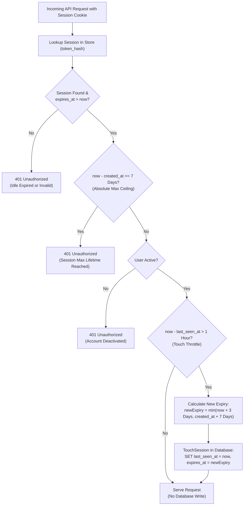

# Platform User Session Lifecycle & Expiration

This document details the lifecycle, expiration model, and database update throttle for authenticated platform user sessions in EnvoyTrade.

---

## 1. Overview & Lifetimes

EnvoyTrade uses a **dual-timer session architecture** combining a sliding idle window with an absolute hard maximum ceiling:

| Parameter | Duration | Purpose |
|---|---|---|
| **Sliding Idle Timeout** (`sessionDuration`) | **3 Days** (72 Hours) | Extends while active. Safely bridges standard 65.5-hour weekend market closures (Friday 3:30 PM to Monday 9:00 AM IST) without logging out traders. |
| **Absolute Hard Ceiling** (`maxSessionDuration`) | **7 Days** (168 Hours) | Hard stop enforced from `created_at`. Requires re-entering credentials once a week for security hygiene. |
| **Touch Throttle Window** (`sessionTouchWindow`) | **1 Hour** | Prevents database write spam. PostgreSQL is touched at most once per hour per active user. |
| **Browser Cookie Max-Age** | **7 Days** (604,800 Seconds) | Matches the hard ceiling so the browser never drops the cookie prematurely while sliding extensions are active. |

---

## 2. Sliding Extension & Hard Ceiling Capping

Whenever an authenticated request arrives at the API:



### Mathematical Capping Rule
When a session is touched:
$$\text{newExpiry} = \min(\text{now} + 3\text{ days},\, \text{createdAt} + 7\text{ days})$$

As the session approaches day 7, extensions are capped at `createdAt + 7 days`. Once the 7-day mark passes, the session is invalidated immediately even if the user was active moments before.

---

## 3. Database Garbage Collection

Expired sessions are purged through two independent defensive layers:

1. **Instant Query-Time Rejection**:
   The primary session lookup query enforces `expires_at > now()` directly in PostgreSQL:
   ```sql
   SELECT ... FROM sessions 
   WHERE token_hash = $1 AND expires_at > now();
   ```
   If a session has expired, the query returns zero rows (`ErrNotFound`), immediately terminating the request with HTTP 401.

2. **Hourly Background Pruner**:
   A dedicated background worker in `cmd/server/main.go` runs every hour:
   ```sql
   DELETE FROM sessions 
   WHERE expires_at <= now();
   ```
   This physically purges dead rows from PostgreSQL to prevent table bloat.
