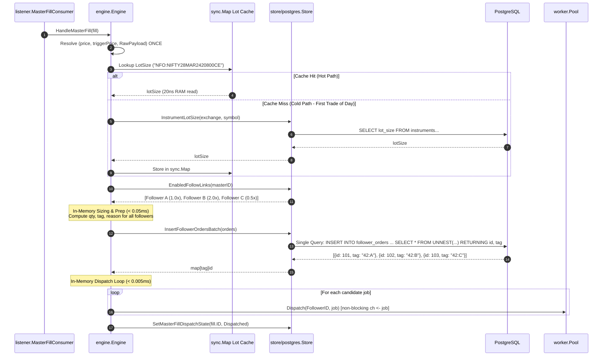

# Implementation Plan: Bulk SQL Fan-Out & Engine CPU Optimization

## Goal Description
Optimize the core copy-trade engine to reduce Stage 2 & Stage 3 fan-out latency from **~15–30ms down to ~1.5–2.0ms flat**, regardless of follower count.
Specifically:
1. **Single Bulk SQL Insert (Batch DB Preparation):** Replace sequential `InsertFollowerOrder` per-follower loops with a single, atomic PostgreSQL parameterized batch insert using `UNNEST(...)` and `ON CONFLICT (idempotency_tag) DO NOTHING RETURNING id, idempotency_tag`.
2. **Eliminate Redundant CPU Parsing:** Parse `fill.Price`, `fill.TriggerPrice`, and `fill.RawPayload` **once** per signal before processing followers, eliminating $N$ repeated JSON unmarshals.
3. **In-Memory Lot Size Caching:** Cache instrument lot sizes using full canonical keys (`EXCHANGE:TRADINGSYMBOL`) with daily midnight reset for zero TTL check overhead during trading hours.

---

## User Review Required

> [!IMPORTANT]
> **Preservation of Core Invariants:**
> - **Idempotency Guarantee:** DB records and deterministic idempotency tags (`{master_fill_id}:{follower_id}`) are committed to PostgreSQL in a single atomic statement **before** any broker dispatch occurs.
> - **Auditable Sizing:** Zero-quantity / sub-lot orders are still recorded in Postgres with `SizingReason` (e.g. `ReasonBelowOneLot`) and marked `SKIPPED`.
> - **Redelivery Safety:** Redelivered fills with existing idempotency tags are safely ignored via `ON CONFLICT DO NOTHING`.
> - **No Breaking Changes to Services:** Existing single-order `InsertFollowerOrder` method is preserved for `squareoff` and `rebalance` services.

---

## Key Design Decisions (Resolved via /grill-me)

1. **Cache Key Strategy: Full Canonical Tradingsymbol (`EXCHANGE:TRADINGSYMBOL`)**
   - e.g. `"NFO:NIFTY28MAR2420800CE"`, `"NSE:RELIANCE"`.
   - **Why:** 
     - Exact 1:1 match with incoming fill; zero regex/string parsing on the hot copy path.
     - 100% immune to NSE multi-expiry lot size transition periods (where near-month and far-month expiries have different lot sizes).
     - Negligible RAM footprint: 1,000 contracts $\approx$ 64 KB RAM.

2. **Cache Lifecycle & Eviction: Daily 1:00 AM IST Reset + Instrument Sync Hook**
   - Active during market hours without any runtime TTL expiration checks (fastest read path).
   - Automatically purged daily at 1:00 AM IST via background timer/scheduler.
   - Cleared via `engine.ClearLotSizeCache()` whenever instrument definitions are refreshed.

---

## Proposed Architecture & Data Flow



---

## Proposed Changes

### 1. Persistence Layer (`internal/store/postgres`)

#### [MODIFY] [`internal/store/postgres/store.go`](file:///Users/msp/MSP/Projects/EnvoyTrade/internal/store/postgres/store.go)
- Add method `InsertFollowerOrdersBatch(ctx context.Context, orders []domain.FollowerOrder) (map[string]int64, error)`.
- Uses a single parameterized PostgreSQL `UNNEST` query:
```sql
INSERT INTO follower_orders (
    master_fill_id, follower_id, idempotency_tag, intended_qty, lot_size, sizing_reason, origin, tradingsymbol, exchange, product, transaction_type, order_type
)
SELECT * FROM UNNEST(
    $1::bigint[], $2::uuid[], $3::text[], $4::integer[], $5::integer[], $6::smallint[], $7::text[], $8::text[], $9::text[], $10::text[], $11::text[], $12::text[]
)
ON CONFLICT (idempotency_tag) DO NOTHING
RETURNING id, idempotency_tag;
```
- Populates 12 parallel typed slices and returns `map[idempotency_tag]orderID` in one DB roundtrip.
- If an order already exists, `ON CONFLICT` skips it and it will not appear in the returned map (signaling redelivery).

#### [MODIFY] [`internal/store/postgres/store_test.go`](file:///Users/msp/MSP/Projects/EnvoyTrade/internal/store/postgres/store_test.go)
- Add integration test `TestInsertFollowerOrdersBatch_AtomicityAndConflictHandling`:
  - Inserts 10 follower orders in a single call.
  - Verifies all 10 rows exist and IDs match.
  - Re-runs batch to assert `ON CONFLICT DO NOTHING` returns empty map without error.

---

### 2. Core Engine Layer (`internal/engine`)

#### [MODIFY] [`internal/engine/engine.go`](file:///Users/msp/MSP/Projects/EnvoyTrade/internal/engine/engine.go)
- Update `Store` interface to include `InsertFollowerOrdersBatch(ctx context.Context, orders []domain.FollowerOrder) (map[string]int64, error)`.
- Add `lotSizeCache sync.Map` to `Engine` struct.
- Add `resolveLotSize(ctx context.Context, exchange, symbol string) (int, error)` helper:
  - Cache key: `exchange + ":" + symbol`.
  - Cache miss queries `store.InstrumentLotSize`, saves in `sync.Map`.
  - Missing instrument (`domain.ErrNotFound`) cached as 0 so `domain.SizeOrder` flags `ReasonBadInstrument` without repeated DB lookups.
- Add `ClearLotSizeCache()` method for daily midnight reset and instrument updates.
- Update `HandleMasterFill`:
  1. Parse execution price, trigger price, and raw JSON fallback **once** before follower processing.
  2. Resolve lot size **once** via `resolveLotSize`.
  3. Pre-size all follower orders in memory and construct `[]domain.FollowerOrder`.
  4. Call `e.store.InsertFollowerOrdersBatch(ctx, orders)`.
  5. Loop through candidate jobs in RAM:
     - If tag not in returned map $\rightarrow$ duplicate/redelivery, skip.
     - If `qty == 0` $\rightarrow$ call `UpdateFollowerOrderFailed("SKIPPED")`, do not dispatch.
     - Dispatch job to `e.dispatcher.Dispatch(link.FollowerID, job)`.
     - If channel full $\rightarrow$ mark dead-lettered.

#### [MODIFY] [`internal/engine/unit_test.go`](file:///Users/msp/MSP/Projects/EnvoyTrade/internal/engine/unit_test.go)
- Implement `InsertFollowerOrdersBatch` on `mockEngineStore`.
- Add unit tests:
  - `TestHandleMasterFill_BatchDispatchAllFollowers`
  - `TestHandleMasterFill_RawPayloadParsedOnce`
  - `TestEngine_LotSizeCacheHitAndClear`

---

### 3. Server Layer (`cmd/server/main.go`)

#### [MODIFY] [`cmd/server/main.go`](file:///Users/msp/MSP/Projects/EnvoyTrade/cmd/server/main.go)
- Start a background midnight ticker goroutine invoking `eng.ClearLotSizeCache()` once daily at 00:00 IST to purge the previous day's contract cache.

---

## Test-Driven Development (TDD) Plan

### Step 1: Unit Test Store Batch Insertion (Red $\rightarrow$ Green)
1. Add test `TestStore_InsertFollowerOrdersBatch` in `internal/store/postgres/store_test.go`.
2. Implement `InsertFollowerOrdersBatch` in `internal/store/postgres/store.go`.
3. Verify: `go test -tags integration ./internal/store/postgres/... -run TestStore_InsertFollowerOrdersBatch`.

### Step 2: Unit Test Engine Batch Sizing & Lot Caching (Red $\rightarrow$ Green)
1. Add tests in `internal/engine/unit_test.go`:
   - `TestHandleMasterFill_BatchDispatchAllFollowers`
   - `TestHandleMasterFill_RawPayloadParsedOnce`
   - `TestEngine_LotSizeCacheHitAndClear`
2. Implement lot cache, price extraction, and bulk fanout in `internal/engine/engine.go`.
3. Verify: `go test -race ./internal/engine/...`.

### Step 3: Integration & Sanity Verification
1. Run full unit and race test suite:
   ```sh
   go test -race ./cmd/server/... ./internal/engine/... ./internal/store/postgres/...
   ```
2. Run full E2E test suite against `testbroker`:
   ```sh
   go test -tags e2e ./tests/e2e/... -v
   ```
3. Re-run local stress benchmark to measure new Stage 2 latency:
   ```sh
   python3 scripts/stress_test_local.py
   python3 scripts/analyze_copy_latency.py
   ```

---

## Verification Plan

### Automated Tests
- Unit & Race: `go test -race ./...`
- Integration: `go test -tags integration ./internal/engine/...`
- E2E: `go test -tags e2e ./tests/e2e/... -v`
- Frontend: `pnpm -C frontend test --run`

### Latency Verification
- Execute local stress test and assert Stage 2 (Engine Sizing & Fan-out) stays under **~1.5–2.0ms flat** across P50/P90/P99 regardless of follower count.
