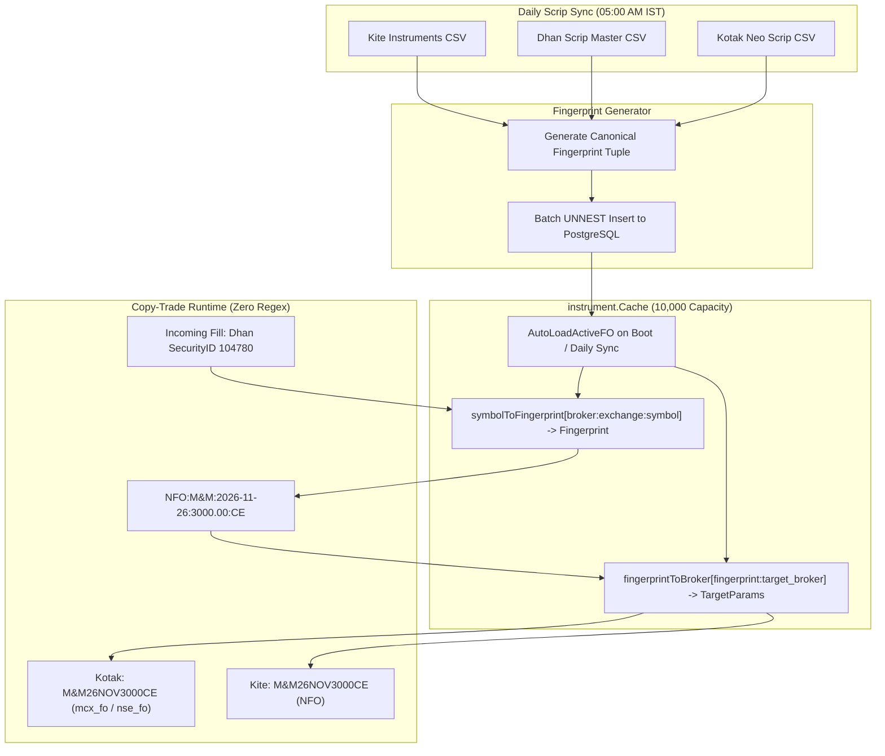

# Universal Exchange Contract Fingerprint: Future Architecture Plan

## Executive Summary
This document outlines the future-state, regex-free instrument resolution architecture for EnvoyTrade. Instead of parsing idiosyncratic broker trading symbols with regular expressions, this architecture leverages the structured contract metadata already present in exchange and broker scrip master files to generate a deterministic, universal contract fingerprint:
```
CANONICAL_FINGERPRINT = EXCHANGE : UNDERLYING_ROOT : EXPIRY_DATE : STRIKE_PRICE : OPTION_TYPE
```

---

## 1. Problem Statement & Motivation
Currently, cross-broker translation relies on regular expressions in `internal/instrument/canonical.go` (`reDhanOption`, `reKotakMCXOption`, `reKiteMonthlyOption`, etc.).
While functional, text-based regex parsing suffers from inherent edge cases:
1. **Special Characters in Underlying**: Stocks like `M&M`, `M&MFIN` contain `&`, and `BAJAJ-AUTO` contains `-`.
2. **Numbers in Index Names**: `NIFTYNXT50` contains `50` adjacent to two-digit expiry years (`26`), creating potential regex greedy capture ambiguities.
3. **Broker Naming Variations**: Different brokers format weekly and monthly contracts differently (e.g. Kite `NIFTY26NOV24000CE` vs Dhan `NIFTY-Nov2026-24000-CE` vs Kotak `NIFTY26NOV24000CE`).

All three brokers (Zerodha, Dhan, Kotak Neo) download daily scrip master files derived from official exchange masters (NSE, BSE, MCX). These files already contain structured columns:
* **Zerodha Kite**: `tradingsymbol`, `name`, `expiry`, `strike`, `instrument_type`, `segment`, `exchange`
* **Dhan**: `SEM_TRADING_SYMBOL`, `SEM_SMST_SECURITY_ID`, `SEM_INSTRUMENT_NAME`, `SEM_EXPIRY_DATE`, `SEM_STRIKE_PRICE`, `SEM_OPTION_TYPE`, `SEM_EXM_EXCH_ID`
* **Kotak Neo**: `pTrdSymbol`, `pSymbol`, `pExpiryDate`, `dStrikePrice`, `pOptionType`, `segment`

---

## 2. Universal Contract Fingerprint Model

### Canonical Fingerprint Structure
Every derivative contract traded in India has an invariant set of 5 exchange attributes:
1. **Exchange**: `NFO`, `BFO`, `MCX` (or `NSE`/`BSE` for cash equities)
2. **Underlying Root**: `M&M`, `NIFTY`, `BANKNIFTY`, `CRUDEOIL`, `GOLDM`
3. **Expiry Date**: Normalized `YYYY-MM-DD` (e.g. `2026-11-26`)
4. **Strike Price**: Normalized decimal string (e.g. `3000.00`, or `0` for futures/equities)
5. **Contract Type**: `CE`, `PE`, `FUT`, `EQ`

```
Option Example:     "NFO:M&M:2026-11-26:3000.00:CE"
Commodity Example:  "MCX:CRUDEOIL:2026-11-17:5000.00:PE"
Futures Example:    "NFO:NIFTY:2026-10-29:0:FUT"
Equity Example:     "NSE:RELIANCE:0:0:EQ"
```

---

## 3. Ingestion & Pre-Allocated In-Memory Indexing



### In-Memory Hash Maps
During `AutoLoadActiveFO`, two O(1) in-memory maps are populated:
1. **Forward Mapping**:
   ```go
   symbolToFingerprint[fmt.Sprintf("%s:%s:%s", broker, exchange, tradingsymbol)] = fingerprint
   // For Dhan: also index by security_id:
   symbolToFingerprint[fmt.Sprintf("dhan:%s:%s", exchangeSegment, securityID)] = fingerprint
   ```
2. **Reverse Target Resolution**:
   ```go
   fingerprintToBroker[fmt.Sprintf("%s:%s", fingerprint, targetBroker)] = TargetInfo{
       ExchangeSegment: exSeg,
       SecurityID:      secID,
       Tradingsymbol:   tradingsymbol,
       LotSize:         lotSize,
   }
   ```

---

## 4. Operational Advantages
1. **0% Regex Dependency**: Zero string pattern matching, zero regex compilation overhead, zero backtracking edge cases.
2. **Extreme Throughput**: Pure integer and string map lookups execute in ~15 to 25 nanoseconds.
3. **Total Immunity to Symbol Quirks**: Brokers can name their symbols with hyphens, underscores, spaces, or ampersands; as long as the underlying exchange tuple matches, resolution is 100% deterministic.
4. **Day Enrichment Solved Natively**: Because expiry date is `YYYY-MM-DD` in both Dhan and Kite, dayless monthly contracts from Kite automatically match the exact expiry date row from Kotak/Dhan.

---

## 5. Phased Implementation Roadmap
- **Phase A**: Add `underlying_name`, `strike_price`, `contract_type` columns to `instruments` table migration.
- **Phase B**: Update `internal/instrument/syncer.go` CSV readers to populate the 5-tuple attributes directly from CSV columns during daily sync.
- **Phase C**: Wire `symbolToFingerprint` and `fingerprintToBroker` into `instrument.Cache` and make it the primary resolution strategy, keeping the updated regex as an offline fallback.
