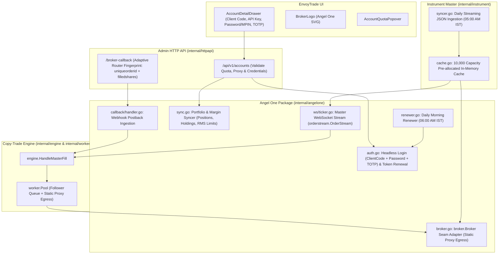

# Angel One SmartAPI Integration: Master Plan & Architectural Roadmap

This document outlines the end-to-end integration of **Angel One SmartAPI** into EnvoyTrade. The implementation follows the consumer-first seam rule (`PLAN.md §1`), strict follower isolation, dedicated static proxy egress, deterministic idempotency, the mandatory [`BROKER_INTEGRATION_CHECKLIST.md`](../../BROKER_INTEGRATION_CHECKLIST.md), and pure Test-Driven Development (TDD).

The official Go SDK is imported directly from GitHub: `github.com/DragoHex/goangelone v0.1.0`.

---

## 1. System Architecture & Component Mapping

---

## 2. Phased Integration Plan

| Phase | Title | Document | Scope & Key Deliverables |
|---|---|---|---|
| **Phase 1** | **Perpetual Authentication & Session Lifecycle** | [`PHASE_01_PERPETUAL_AUTH_LIFECYCLE.md`](PHASE_01_PERPETUAL_AUTH_LIFECYCLE.md) | `github.com/DragoHex/goangelone v0.1.0` dependency, ClientCode + Password/MPIN + TOTP headless login, refresh token renewal, daily morning renewer daemon (06:00 AM IST), AES-GCM encryption, TDD test matrix (positive, negative, clock-drift edge cases). |
| **Phase 2** | **Broker Adapter & Execution Seam** | [`PHASE_02_BROKER_ADAPTER_EXECUTION.md`](PHASE_02_BROKER_ADAPTER_EXECUTION.md) | `broker.Broker` seam implementation in `internal/angelone/broker.go`, `PlaceOrder`, `CancelOrder`, `GetOrders`, `GetOrderHistory`, `GetPositions`, dedicated forward proxy routing via `RESTClientFor` / `WithProxy`, domain sentinel error mapping. |
| **Phase 3** | **Portfolio & Margin Synchronization** | [`PHASE_03_PORTFOLIO_MARGIN_SYNC.md`](PHASE_03_PORTFOLIO_MARGIN_SYNC.md) | Position, holding, and RMS limits synchronization, normalized product codes, debounced syncer integration, transparent re-authentication on 401, account status transitions. |
| **Phase 4** | **Master Order Stream (WebSocket)** | [`PHASE_04_MASTER_ORDER_STREAM.md`](PHASE_04_MASTER_ORDER_STREAM.md) | Master execution streaming via `goangelone/orderstream`, terminal status filtering, reverse symbol translation via `instrument.Cache.ResolveToSymbol`, auto-reconnect backoff with on-demand catch-up reconciliation hook, leak-free shutdown. |
| **Phase 5** | **Instrument Master Sync & Cache** | [`PHASE_05_INSTRUMENT_MASTER_SYNC.md`](PHASE_05_INSTRUMENT_MASTER_SYNC.md) | Daily streaming JSON download (`OpenAPIScripMaster.json`), chunked JSON streaming without heap bloat, filtering cash equities to save derivatives/commodities, transactional prune on 100% success, chunked batch insert (5,000 via UNNEST), pre-loading active F&O into 10,000 cache. |
| **Phase 6** | **Postback Webhook Ingestion** | [`PHASE_06_POSTBACK_WEBHOOK_INGESTION.md`](PHASE_06_POSTBACK_WEBHOOK_INGESTION.md) | Webhook callback handler in `internal/angelone/callback`, registration with `AdaptiveRouter` using zero-alloc fingerprinting (`"uniqueorderid"` & `"filledshares"`), HTTP 200 guarantee, dispatching `MasterFill` and `OrderUpdate`. |
| **Phase 7** | **Admin HTTP API, Quotas & Frontend UI** | [`PHASE_07_ADMIN_API_AND_FRONTEND_UI.md`](PHASE_07_ADMIN_API_AND_FRONTEND_UI.md) | Whitelist `angelone` in Admin API `/api/v1/accounts`, quota verification, proxy compatibility check, frontend `BrokerLogo.tsx` SVG, `AccountDetailDrawer.tsx` form inputs for Angel One credentials. |
| **Phase 8** | **Scheduled Routines & E2E Verification** | [`PHASE_08_SCHEDULED_ROUTINES_AND_E2E.md`](PHASE_08_SCHEDULED_ROUTINES_AND_E2E.md) | Server wiring in `cmd/server/main.go`, `docs/CRON_AND_PERIODIC_ROUTINES.md` catalog update, Podman testcontainers integration tests, full test suite pass. |

---

## 3. Mandatory Broker Integration Checklist Alignment

| Operational Area | Requirement | Architecture Strategy |
|---|---|---|
| **1. Instrument Master** | Streaming download, no heap bloat | Streaming JSON decoder (`json.NewDecoder`) over `OpenAPIScripMaster.json`, filtering out cash equities, batch UNNEST 5,000 chunks, `VACUUM ANALYZE`. |
| **2. Auth & Tokens** | AES-GCM encryption, perpetual login | `GenerateSession` (ClientCode + Password + TOTP) + `RenewAccessToken`, morning renewer at `06:00 AM IST`, `accountPool.Evict` callback. |
| **3. Broker Adapter** | Consumer-first seam rule (`broker.Broker`) | `internal/angelone.Broker` implementing `PlaceOrder`, `CancelOrder`, `GetOrders`, `GetOrderHistory`, `GetPositions`. Proxy via `RESTClientFor`. |
| **4. Master Ticker** | Isolated WebSocket stream | `internal/angelone/ws.MasterTicker` wrapping `goangelone/orderstream`, filtering terminal statuses, reverse symbol translation. |
| **5. Postback Webhook** | Adaptive router, 200 OK guarantee | Zero-alloc fingerprint (`uniqueorderid` + `filledshares`), parse `PostbackPayload`, canonical dispatch to memchan queues. |
| **6. Recon & Drift** | REST order inspection, stuck order sweeps | Implement `GetOrders` and `GetOrderHistory`, fail fast on unreachable broker (`ErrBrokerUnreachable`). |
| **7. Portfolio Sync** | Positions, Holdings, RMS limits | Synchronize `RMSLimit` (Cash, Margin, Collateral, M2M), positions, holdings; 500ms debouncing. |
| **8. Admin API** | Whitelist enum, quotas, proxy match | Whitelist `angelone`, enforce user quotas, validate proxy IP pool compatibility. |
| **9. Scheduled Routines** | Documentation integrity | Document 06:00 AM IST token renewer and 05:00 AM IST instrument sync in `docs/CRON_AND_PERIODIC_ROUTINES.md`. |
