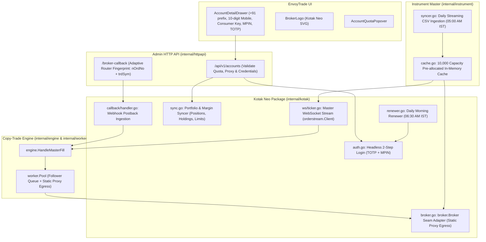

# Kotak Neo Integration: Master Plan & Architectural Roadmap

This document outlines the end-to-end integration of **Kotak Neo Trade API** into EnvoyTrade. The implementation follows the consumer-first seam rule (PLAN.md §1), strict follower isolation, dedicated static proxy egress, deterministic idempotency, and pure Test-Driven Development (TDD).

The official Go SDK is imported directly from GitHub: `github.com/DragoHex/gokotakneo`.

---

## 1. System Architecture & Component Mapping

---

## 2. Phased Integration Plan

| Phase | Title | Document | Scope & Key Deliverables |
|---|---|---|---|
| **Phase 0** | **Kotak Neo SDK Fixes** | [`GOKOTAKNEO_SDK_FIXES.md`](GOKOTAKNEO_SDK_FIXES.md) / [`SDK_FIX_REQUEST.md`](SDK_FIX_REQUEST.md) | Fix critical bugs in `gokotakneo`: 6s watchdog disconnect, missing `OrderUpdate` fields (`trnsTp`, `prod`), `BrokerTime` format, `SetSessionTokens` auth state, `Close()` method. |
| **Phase 1** | **Perpetual Authentication & Session Lifecycle** | [`PHASE_01_PERPETUAL_AUTH_LIFECYCLE.md`](PHASE_01_PERPETUAL_AUTH_LIFECYCLE.md) | `github.com/DragoHex/gokotakneo` dependency, 2-step TOTP/MPIN headless login, token expiry, mobile number normalization (+91), scheduled morning renewer daemon (06:30 AM IST), TDD test matrix. |
| **Phase 2** | **Broker Adapter & Execution Seam** | [`PHASE_02_BROKER_ADAPTER_EXECUTION.md`](PHASE_02_BROKER_ADAPTER_EXECUTION.md) | `broker.Broker` implementation, order placement/modification/cancellation, positions and order history inspection, error translation to domain sentinels, static proxy egress. |
| **Phase 3** | **Portfolio & Margin Synchronization** | [`PHASE_03_PORTFOLIO_MARGIN_SYNC.md`](PHASE_03_PORTFOLIO_MARGIN_SYNC.md) | Position, holding, and fund limits synchronization, account state transitions, debounced syncer integration, transparent re-authentication on 401. |
| **Phase 4** | **Master Order Stream** | [`PHASE_04_MASTER_ORDER_STREAM.md`](PHASE_04_MASTER_ORDER_STREAM.md) | Master execution streaming via `gokotakneo/orderstream`, terminal status filtering, reverse symbol translation, auto-reconnection with on-demand catch-up reconciliation. |
| **Phase 5** | **Instrument Master Sync & Cache** | [`PHASE_05_INSTRUMENT_MASTER_SYNC.md`](PHASE_05_INSTRUMENT_MASTER_SYNC.md) | Daily streaming CSV parsing (05:00 AM IST) for derivatives (`nse_fo`, `bse_fo`, `mcx_fo`), transactional all-or-nothing pruning, chunked batch insert (5,000 via UNNEST), pre-loading active F&O into 10,000 cache. |
| **Phase 6** | **HTTP Admin API, Quotas & Frontend UI** | [`PHASE_06_ADMIN_API_AND_FRONTEND_UI.md`](PHASE_06_ADMIN_API_AND_FRONTEND_UI.md) | Whitelist `kotakneo` in Admin API, quota checking, proxy compatibility, UI `AccountDetailDrawer` with separate `+91` country prefix component and strict 10-digit mobile number input validation. |
| **Phase 7** | **Scheduled Routines & E2E Verification** | [`PHASE_07_SCHEDULED_ROUTINES_AND_E2E.md`](PHASE_07_SCHEDULED_ROUTINES_AND_E2E.md) | Update `docs/CRON_AND_PERIODIC_ROUTINES.md`, integration tests via Podman testcontainers, complete end-to-end regression testing. |
